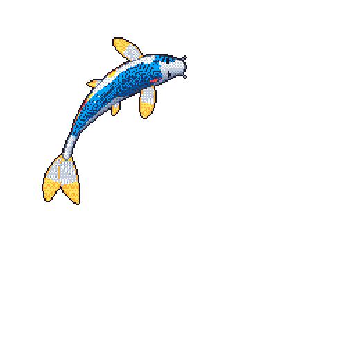

<!-- ============================================================
     HERO — assets/hero.svg (animated terminal banner)
============================================================ -->

 

<!-- ============================================================
     01 · TECH STACK
============================================================ -->

<table>
  <tr>
    <td align="right"><b><code>LANGUAGES</code></b></td>
    <td>
      
      
      
      
    </td>
  </tr>
  <tr>
    <td align="right"><b><code>ML &amp; AI</code></b></td>
    <td>
      
      
      
      
      
      
    </td>
  </tr>
  <tr>
    <td align="right"><b><code>BACKEND &amp; APIs</code></b></td>
    <td>
      
      
      
    </td>
  </tr>
  <tr>
    <td align="right"><b><code>CLOUD &amp; INFRA</code></b></td>
    <td>
      
      
      
      
      
    </td>
  </tr>
  <tr>
    <td align="right"><b><code>ANALYTICS &amp; BI</code></b></td>
    <td>
      
      
    </td>
  </tr>
</table>

 

<!-- ============================================================
     02 · GITHUB STATS
============================================================ -->

  

 

<!-- ============================================================
     03 · CONTRIBUTION SNAKE — drawn by .github/workflows/snake.yml
============================================================ -->

<picture>
  <source media="(prefers-color-scheme: dark)" srcset="https://raw.githubusercontent.com/ankan00V/ankan00V/output/snake-dark.svg"/>
  <source media="(prefers-color-scheme: light)" srcset="https://raw.githubusercontent.com/ankan00V/ankan00V/output/snake-light.svg"/>
  
</picture>

 

<!-- ============================================================
     04 · KOI POND — redrawn daily by .github/workflows/koi.yml
============================================================ -->

<table>
  <tr>
    <td align="center"></td>
    <td>
      <code>$ koi --status</code>  
      🍥 fed by commits 
      🎨 coloured by languages 
      🌱 grows daily
    </td>
  </tr>
</table>

 

<!-- ============================================================
     FOOTER — assets/footer.svg
============================================================ -->

